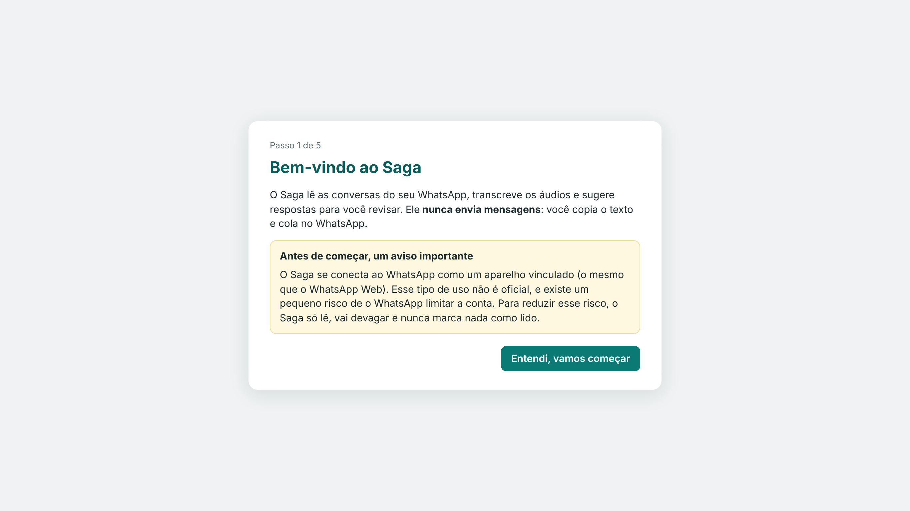
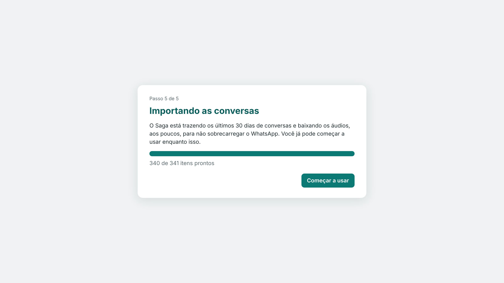
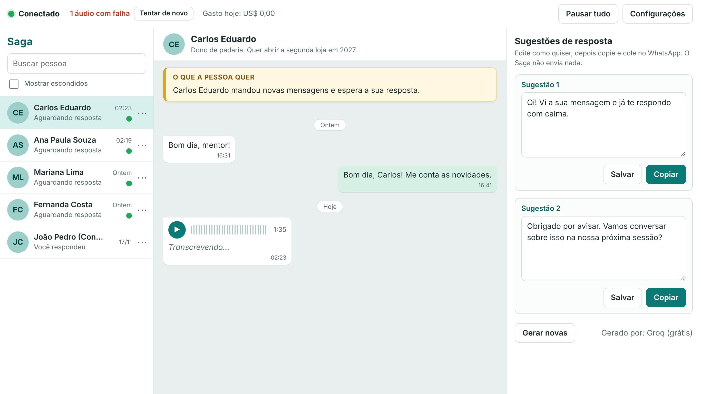
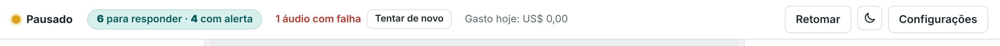
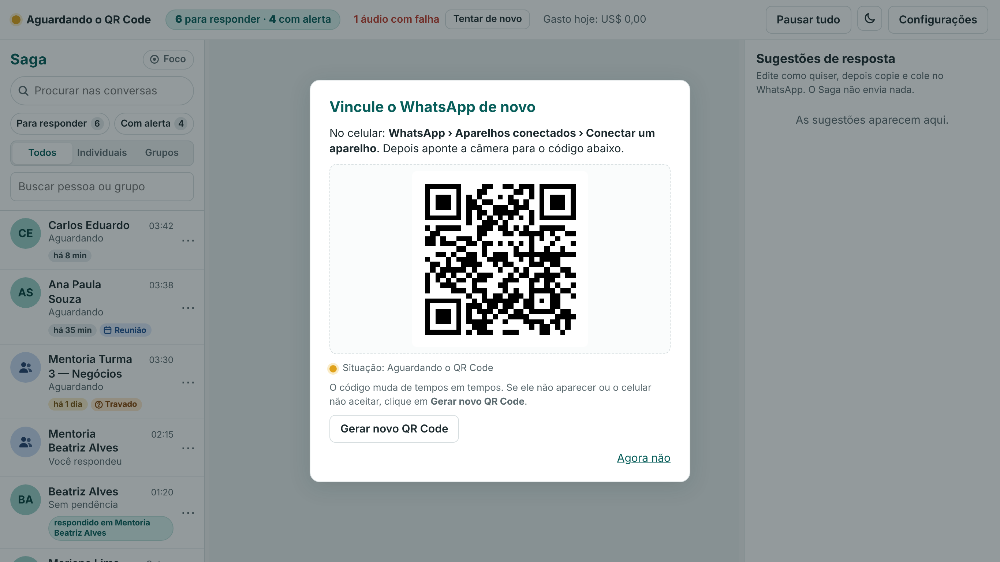

# Guia de instalação do Saga

Este guia é para quem **não usa terminal**. Você só vai clicar e copiar/colar. Leva uns 10 minutos.

O Saga lê as suas conversas individuais do WhatsApp (dos últimos 30 dias), transcreve os áudios e sugere respostas. **Ele nunca envia mensagens**: você copia a sugestão e cola no WhatsApp.

## 1. Baixar o instalador

1. No navegador, abra: <https://github.com/caionorcia/saga/releases/latest>
2. Role a página até a parte **Assets** (arquivos).
3. Clique em **Saga-Setup-…exe** (o número da versão aparece no nome). O download começa.
4. Quando terminar, abra o arquivo pela lista de downloads do navegador ou pela pasta **Downloads**.

## 2. Instalar (aviso do Windows)

Na primeira vez, o Windows pode mostrar uma tela azul: **"O Windows protegeu o computador"**. Isso é normal: o Saga é um programa novo e ainda não tem a assinatura paga que a Microsoft reconhece. Não significa que há um vírus.

1. Clique em **Mais informações** (um texto pequeno, logo abaixo da mensagem).
2. Vai aparecer o botão **Executar assim mesmo**. Clique nele.
3. O instalador abre. Clique em **Instalar** e aguarde.
4. No fim, o Saga abre sozinho e um atalho **Saga** aparece na área de trabalho.

## 3. Assistente de configuração

O Saga mostra um assistente em 5 passos.

### Passo 1: Boas-vindas

Leia o aviso e clique em **Entendi, vamos começar**. O Saga usa o WhatsApp como um aparelho vinculado (como o WhatsApp Web). Esse uso não é oficial e há um pequeno risco de o WhatsApp limitar a conta; por isso o Saga só lê, vai devagar e nunca marca nada como lido.

### Passo 2: Chave do Groq (grátis)

A chave é uma "senha" que permite ao Saga usar a inteligência artificial do Groq, de graça. Para criar:

1. Abra <https://console.groq.com/keys> e entre com a sua conta Google ou e-mail (crie uma conta se for a primeira vez).
2. Clique em **Create API Key** (criar chave) e dê um nome, por exemplo "Saga".
3. Clique em **Copy** (copiar). A chave começa com `gsk_`. Ela só aparece uma vez.
4. Volte ao Saga, cole no campo e clique em **Testar**. Deve aparecer **Chave funcionando ✓**.
5. Clique em **Continuar**.

### Passo 3: Chave do Claude (opcional)

Você pode **pular** este passo. É para quem prefere que o Claude (pago, por uso) escreva as sugestões. Dá para configurar depois em **Configurações**.

### Passo 4: Vincular o WhatsApp (QR Code)

1. No celular: **WhatsApp › Aparelhos conectados › Conectar um aparelho**.
2. Aponte a câmera do celular para o QR Code na tela do computador.
3. O código troca de tempos em tempos. Se ele não aparecer ou o celular não aceitar, clique em **Gerar novo QR Code**.

Quando vincular, o assistente avança sozinho.

Embaixo do código aparece a **Situação** da conexão. Se algo der errado, o Saga explica o motivo e mostra o botão **Tentar de novo**. Se o QR Code não aparecer, veja [QR Code não aparece](#qr-code-não-aparece).

### Passo 5: Importação

O Saga traz os últimos 30 dias de conversas e baixa os áudios aos poucos, de propósito devagar, para não sobrecarregar o WhatsApp. Você já pode clicar em **Começar a usar**.

## 4. Usando o Saga

- **Esquerda:** as conversas. A bolinha verde indica que a pessoa está aguardando a sua resposta.
- **Meio:** a conversa, com os áudios já transcritos e o resumo "O que a pessoa quer".
- **Direita:** sugestões de resposta. Edite como quiser, clique em **Copiar** e cole no WhatsApp. **Salvar** guarda a sua versão final para o Saga aprender o seu jeito. **Gerar novas** pede outras sugestões.

Fechar a janela (no X) **não** encerra o Saga: ele continua na bandeja, perto do relógio. Para sair de verdade, clique com o botão direito no ícone e escolha **Sair**.

## 5. O que significa a faixa de cima

A faixa no topo mostra como o Saga está.

| Como aparece | O que significa | O que fazer |
|---|---|---|
|  | **Conectado**: tudo certo. "Tentar de novo" aparece só se algum áudio falhou. | Nada. |
|  | **Pausado**: você (ou o Saga) parou os downloads. | Clique em **Retomar**. |
|  | **Reconectando em …**: a internet caiu ou o WhatsApp oscilou. | Aguarde: o Saga tenta de novo sozinho, com esperas crescentes. |
|  | **Pouco espaço no disco**: menos de 1 GB livre; os downloads param. | Libere espaço e clique em **Retomar**. |
|  | **Desconectado — vincule novamente**: o WhatsApp foi desvinculado do celular. | Veja a seção abaixo. |

Outros avisos: **Desconectado — tente de novo** (clique em **Reconectar**); **Conta restrita pelo WhatsApp** (o WhatsApp limitou a conta: o Saga para tudo e mostra um aviso vermelho; use o WhatsApp só pelo celular por alguns dias e, quando quiser voltar, clique em **Reconectar**); **Conectado em outro lugar** (feche o outro aparelho ou programa e clique em **Reconectar**); **Versão do app desatualizada** (o WhatsApp recusou a conexão mesmo depois de o Saga buscar a versão mais nova do WhatsApp Web: clique em **Reconectar**; se continuar, instale a versão nova do Saga, veja "Atualizações"). Os avisos de conta restrita e de conectado em outro lugar continuam valendo mesmo se você fechar e abrir o Saga: ele só volta a se conectar quando você clicar em **Reconectar**. Já o de versão desatualizada some ao abrir o Saga de novo: ele busca a versão mais nova e tenta outra vez.

Também podem aparecer avisos sobre a transcrição dos áudios: **Transcrição pausada — confira a chave** (a chave não está configurada ou foi recusada: veja em **Configurações**), **Transcrição pausada — teto de gasto de hoje atingido** (só com a transcrição paga da OpenAI; volta sozinha no dia seguinte, ou aumente o teto em **Configurações**) e **Sem internet — transcrição volta em instantes**.

### Apareceu "vincule novamente"

Acontece quando o aparelho é removido em **WhatsApp › Aparelhos conectados** no celular. Clique em **Reconectar**: o Saga mostra um QR Code novo por cima das conversas. No celular, abra **WhatsApp › Aparelhos conectados › Conectar um aparelho** e aponte a câmera para o código. Se o código não aparecer ou expirar, clique em **Gerar novo QR Code**. As conversas já importadas continuam guardadas.

### QR Code não aparece

Se o passo do QR Code fica em "Preparando o QR Code…":

1. **Espere uns 30 segundos.** Na primeira vez o Saga confere a versão atual do WhatsApp Web antes de pedir o código.
2. Clique em **Tentar de novo** (ou em **Gerar novo QR Code**).
3. **Antivírus e firewall:** confira se eles permitem que o Saga acesse a internet. Alguns antivírus bloqueiam a conexão com o WhatsApp sem avisar; libere o `Saga.exe` (ou adicione o Saga às exceções) e clique em **Tentar de novo**. Em redes de empresa ou com proxy, teste em outra rede (por exemplo, o roteador do celular).
4. Se depois de 45 segundos ainda não aparecer, o Saga mostra "O QR Code está demorando". Clique em **Ver detalhes** e depois em **Copiar diagnóstico**, e cole o texto numa mensagem para o suporte. O diagnóstico traz só as versões do app e o registro da conexão: **nunca** as suas mensagens nem as chaves. O mesmo botão fica em **Configurações › Diagnóstico**, junto com **Abrir pasta de registros** (o arquivo `saga.log`).

### Botão Pausar

**Pausar tudo** interrompe os downloads de áudio na hora (útil se o computador ou a internet estiver lento). **Retomar** continua de onde parou. O Saga também pausa sozinho quando o espaço em disco acaba.

## 6. Atualizações

Quando existe uma versão nova, aparece na faixa de cima:

Clique em **Atualizar**. O Saga baixa a versão nova e a instala **quando você fechar o Saga** (pelo ícone da bandeja › **Sair**). Se quiser instalar na hora, clique em **Reiniciar e atualizar**: o Saga fecha com cuidado, instala a versão nova e abre de novo. Se preferir, baixe o novo `.exe` em <https://github.com/caionorcia/saga/releases/latest> e instale por cima da versão antiga: suas conversas e configurações são mantidas.

## 7. Privacidade

- Suas conversas, áudios e configurações ficam **neste computador** (pasta de dados do Saga no seu usuário do Windows). Não existe servidor do Saga.
- A chave de acesso é guardada com a criptografia do Windows.
- Só saem do computador: o **texto das conversas** e os **áudios**, enviados para a IA que você escolheu (Groq e, se configurado, Claude ou OpenAI) para transcrever e gerar sugestões.
- O Saga só lê conversas individuais. Grupos e status são ignorados.

## 8. Desinstalar

**Configurações do Windows › Aplicativos › Saga › Desinstalar**. Depois, para apagar também os dados, apague a pasta `Saga` dentro de `%APPDATA%` (cole esse nome na barra de endereços do Explorador de Arquivos).
