# Guia de instalação do SagaZap

Este guia é para quem **não usa terminal**. Você só vai clicar e copiar/colar. Leva uns 10 minutos.

O SagaZap lê as suas conversas individuais do WhatsApp (dos últimos 30 dias), transcreve os áudios e sugere respostas. **Ele nunca envia mensagens**: você copia a sugestão e cola no WhatsApp.

## 1. Baixar o instalador

1. No navegador, abra: <https://github.com/caionorcia/saga/releases/latest>
2. Role a página até a parte **Assets** (arquivos).
3. Clique em **SagaZap-Setup-…exe** (o número da versão aparece no nome). O download começa.
4. Quando terminar, abra o arquivo pela lista de downloads do navegador ou pela pasta **Downloads**.

## 2. Instalar (aviso do Windows)

Na primeira vez, o Windows pode mostrar uma tela azul: **"O Windows protegeu o computador"**. Isso é normal: o SagaZap é um programa novo e ainda não tem a assinatura paga que a Microsoft reconhece. Não significa que há um vírus.

1. Clique em **Mais informações** (um texto pequeno, logo abaixo da mensagem).
2. Vai aparecer o botão **Executar assim mesmo**. Clique nele.
3. O instalador abre. Clique em **Instalar** e aguarde.
4. No fim, o SagaZap abre sozinho e um atalho **SagaZap** aparece na área de trabalho.

## 3. Assistente de configuração

O SagaZap mostra um assistente em 5 passos.

### Passo 1: Boas-vindas

Leia o aviso e clique em **Entendi, vamos começar**. O SagaZap usa o WhatsApp como um aparelho vinculado (como o WhatsApp Web). Esse uso não é oficial e há um pequeno risco de o WhatsApp limitar a conta; por isso o SagaZap vai devagar, só responde a quem falou com você nos últimos 30 dias, só envia o que você confirma e só marca como lida a conversa que você respondeu.

### Passo 2: Chave do Groq (grátis)

A chave é uma "senha" que permite ao SagaZap usar a inteligência artificial do Groq, de graça. Para criar:

1. Abra <https://console.groq.com/keys> e entre com a sua conta Google ou e-mail (crie uma conta se for a primeira vez).
2. Clique em **Create API Key** (criar chave) e dê um nome, por exemplo "SagaZap".
3. Clique em **Copy** (copiar). A chave começa com `gsk_`. Ela só aparece uma vez.
4. Volte ao SagaZap, cole no campo e clique em **Testar**. Deve aparecer **Chave funcionando ✓**.
5. Clique em **Continuar**.

### Passo 3: Chave do Claude (opcional)

Você pode **pular** este passo. É para quem prefere que o Claude (pago, por uso) escreva as sugestões. Dá para configurar depois em **Configurações**.

### Passo 4: Vincular o WhatsApp (QR Code)

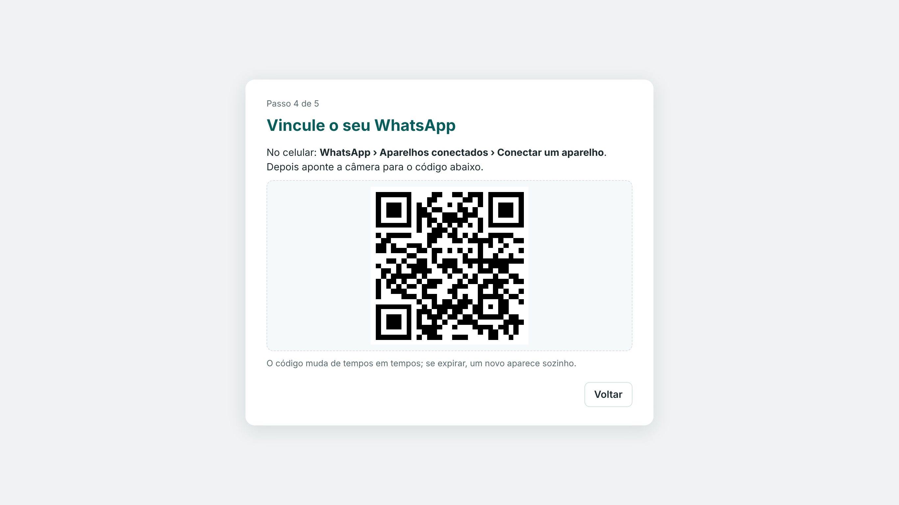

1. No celular: **WhatsApp › Aparelhos conectados › Conectar um aparelho**.
2. Aponte a câmera do celular para o QR Code na tela do computador.
3. O código troca de tempos em tempos. Se ele não aparecer ou o celular não aceitar, clique em **Gerar novo QR Code**.

Quando vincular, o assistente avança sozinho.

Embaixo do código aparece a **Situação** da conexão. Se algo der errado, o SagaZap explica o motivo e mostra o botão **Tentar de novo**. Se o QR Code não aparecer, veja [QR Code não aparece](#qr-code-não-aparece).

### Passo 5: Importação

O SagaZap traz os últimos 30 dias de conversas e baixa os áudios aos poucos, de propósito devagar, para não sobrecarregar o WhatsApp. Você já pode clicar em **Começar a usar**.

## 4. Usando o SagaZap

- **Esquerda:** as conversas, pessoas e grupos. O selo "há 3 h" indica que alguém está aguardando a sua resposta e há quanto tempo (num grupo: a última mensagem não é sua). No topo, escolha **Todos**, **Individuais** ou **Grupos**; o SagaZap lembra a escolha. A busca procura pessoas e grupos.
- **Meio:** a conversa, com os áudios já transcritos e o resumo "O que a pessoa quer". Nos grupos, cada mensagem mostra o nome de quem mandou, as que mencionam você aparecem marcadas, e o resumo se chama "O que pedem a você": perguntas e pedidos para você, não um resumo do grupo inteiro.
- **Direita:** sugestões de resposta (num grupo, mensagens para você postar no grupo). Edite como quiser e clique em **Enviar** (você confirma cada envio; veja "Enviar pelo SagaZap" abaixo), ou clique em **Copiar** e cole no WhatsApp. **Enviar**, **Copiar** e **Salvar** escolhem a resposta: as outras sugestões somem e ela fica marcada como "✓ Resposta escolhida" (**Mostrar as outras sugestões** traz elas de volta). Escolher guarda a sua versão final, e também o que você deixou de lado, para o SagaZap aprender o seu jeito. **Gerar novas** pede outras sugestões.

### Fila do dia e alertas (versão 0.2.0)

Para ninguém ficar sem resposta:

- **Para responder**: o botão no alto da lista mostra só quem está esperando a sua resposta, **quem espera há mais tempo primeiro**. O número no botão diz quantas conversas são. O selo de cada conversa diz há quanto tempo a pessoa espera: cinza até 1 dia, **amarelo** de 1 a 2 dias e **vermelho** depois de 2 dias. Clique de novo no botão para voltar a ver todas.
- **Com alerta**: mostra as conversas que pedem atenção, as mais graves primeiro. Os alertas aparecem como etiquetas coloridas na conversa: **Urgente** (pressa ou prazo), **Desânimo** (frustração, vontade de desistir, reclamação), **Travado** (uma dúvida impedindo de avançar), **Reunião** (pedido de reunião, ligação ou horário) e **Esperando 2 dias** (sem resposta há mais de 2 dias).
- Ao abrir a conversa, uma faixa logo abaixo do nome explica cada alerta. Clique no texto do alerta para ir até a mensagem; clique em **Resolver** para tirá-lo da lista.
- Quando você responde pelo WhatsApp, os alertas de Urgente, Travado, Reunião e Esperando somem sozinhos. O de **Desânimo** fica até você clicar em **Resolver**, para você lembrar de acompanhar a pessoa.
- Na faixa de cima, "**5 para responder · 2 com alerta**" mostra o resumo do dia; clique nele para abrir a lista **Para responder**.

Os alertas são procurados aos poucos, em segundo plano, pela IA **gratuita** da Groq (a mesma chave da transcrição), uma conversa de cada vez e só quando chega mensagem nova. O SagaZap **nunca** usa o Claude (pago) para isso. Sem a chave da Groq, só o alerta "Esperando" funciona.

### Ensinar o SagaZap: 👍 e 👎 nos alertas (versão 0.2.1)

- Cada alerta da IA tem dois botões na faixa da conversa: **👍** (o alerta está certo) e **👎** (está errado). O 👍 não tira o alerta: ele continua até você resolver.
- O **👎** abre a janela "**O que está errado neste alerta?**". Escolha o motivo (por exemplo "Era brincadeira/ironia" ou "Não era comigo"); em "**Não é esse tipo de alerta**", diga qual seria o certo — o SagaZap troca o alerta por esse, marcado como "marcado por você". Se quiser, explique com suas palavras. Ao salvar, o alerta errado sai da lista.
- O SagaZap deixou passar algo? Clique em "**Faltou um alerta?**", no canto do cabeçalho da conversa, escolha o tipo e, se quiser, a mensagem e um comentário. O alerta é criado na hora.
- Cada avaliação vira um exemplo para a IA: as próximas análises levam alguns desses exemplos e o SagaZap não repete um alerta que você marcou como errado na mesma mensagem.
- Em **Configurações → Qualidade dos alertas** você vê, por tipo, quantos 👍, 👎 e "faltou" houve nos últimos 30 dias e a % de acerto. O botão **Exportar avaliações (CSV)** salva uma planilha que abre no Excel. Com "**Anonimizar nomes**" (ligado por padrão), o nome de cada conversa vira "Contato 1", "Contato 2"… **Atenção:** a planilha traz trechos das mensagens; guarde e compartilhe com cuidado.

Fechar a janela (no X) **não** encerra o SagaZap: ele continua na bandeja, perto do relógio. Para sair de verdade, clique com o botão direito no ícone e escolha **Sair**.

### "Para responder" mais certeiro (versão 0.2.2)

- Nem toda mensagem pede resposta. Quando a pessoa só manda "**obrigado**", "**ok**", "**valeu**", um **emoji** (👍 🙏) ou uma figurinha depois da sua resposta, o SagaZap tira a conversa de **Para responder** sozinho. A IA gratuita também avisa quando a mensagem é só informativa ou, num grupo, quando a conversa é entre os participantes e não com você. Na dúvida, a conversa fica na lista.
- Essas conversas continuam em **Todos**, com a etiqueta cinza "**Não precisa responder**". Ao abrir, aparece "O SagaZap acha que esta conversa não precisa de resposta" e o motivo. Se ele errou, clique em **Precisa sim** e a conversa volta para a lista. Se ele acertou, clique em 👍.
- O SagaZap deixou alguém na lista sem precisar? Clique em **Não precisa responder** (no alto da conversa, ou no ícone 💬✓ ao lado do nome, na lista **Para responder**) e escolha o motivo: "Era só agradecimento / ok / emoji", "Respondi no grupo dele", "Respondi por ligação/pessoalmente", "Mensagem de grupo que não é comigo", "Conversa encerrada" ou "Outro". A conversa sai da lista e o alerta "Esperando" some.
- Isso vale até a pessoa mandar outra mensagem: aí a conversa volta para a lista e o SagaZap olha de novo.
- O alerta **Esperando** e os alertas "marcados por você" agora também têm 👍 e 👎. No Esperando, o 👍 diz "precisa mesmo responder" e o 👎 abre a mesma janela "Por que esta conversa não precisa de resposta?".
- Tudo isso ensina o SagaZap. Em **Configurações → Qualidade dos alertas**, a linha **Para responder** mostra quantas conversas você tirou, quantas devolveu e a % de acerto do SagaZap; essas avaliações também vão na planilha exportada (tipo "para_responder").

### Respondido no grupo do mentorado (versão 0.2.3)

Cada mentorado costuma ter o próprio grupo, e é lá que você responde. O SagaZap agora entende isso sozinho:

- Se a pessoa mandou mensagem no privado e **depois** disso você escreveu num **grupo pequeno** de que ela participa (até 10 pessoas, como o grupo dela com você), a conversa sai de **Para responder** (e não ganha o alerta "Esperando").
- Em grupos maiores (uma turma, por exemplo), um recado geral **não** conta: só conta se você **marcou a pessoa** (@nome) ou **respondeu a uma mensagem dela** (citando). Enquanto o SagaZap ainda não sabe quantas pessoas o grupo tem, ele trata como grupo grande.
- Na lista **Todos**, a conversa aparece com a etiqueta "**respondido em** _nome do grupo_".
- Ao abrir a conversa, aparece "**Respondido no grupo** _nome do grupo_ **às** _hora_". Clique no nome do grupo para abrir a conversa do grupo.
- Se ainda precisa responder no privado, clique em **Precisa sim**: a conversa volta para a lista (e o SagaZap aprende com isso). Se estiver certo, clique em 👍.
- O SagaZap sabe quem está em cada grupo pela lista de participantes (consultada uma vez por dia, só leitura) e por quem já escreveu no grupo. Logo depois de atualizar, a lista de participantes é buscada na primeira conexão.

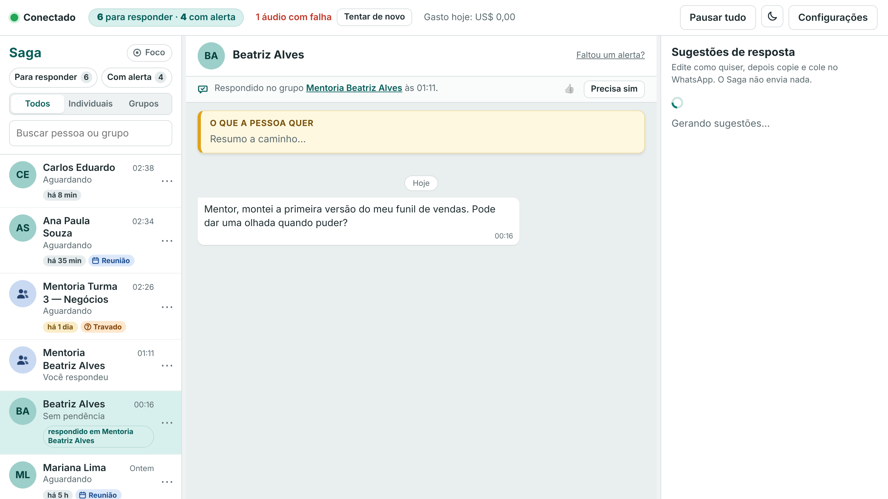

### Tema escuro (versão 0.2.3)

Em **Configurações › Tema**, escolha **Automático (do Windows)** (o padrão: segue o modo claro/escuro do Windows), **Claro** ou **Escuro**. Para trocar rápido, use o botão de **sol/lua** na barra de cima, ao lado de **Configurações**. O QR Code continua em fundo branco para o celular conseguir ler.

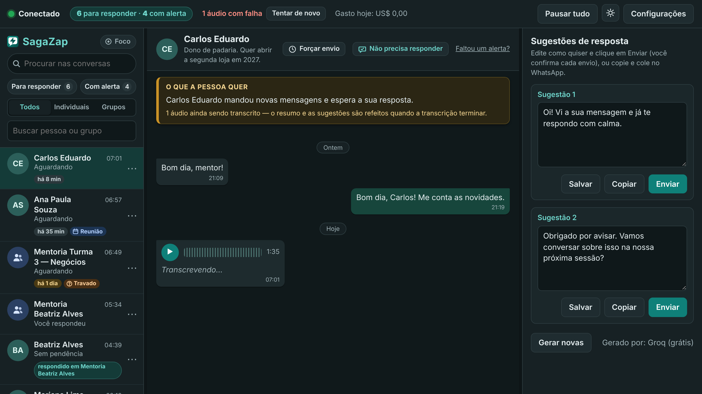

### Base de conhecimento do seu método (versão 0.3.0)

Ensine ao SagaZap o seu método, para as sugestões responderem as dúvidas dos mentorados com o que você ensina.

1. Abra **Configurações › Base de conhecimento**.
2. Clique em **Importar pacote / skill** e escolha o arquivo `.zip` ou `.skill` do seu material (ou clique em **ou uma pasta** para escolher uma pasta). Para um arquivo solto, use **Adicionar arquivo** (`.md`, `.txt` ou `.docx`); para um texto rápido, **Colar texto** (título + texto). PDF ainda não é aceito: salve como `.docx` ou `.txt`.
3. O SagaZap lê os arquivos de texto, ignora repetidos, imagens e `.zip` dentro do `.zip`, divide cada arquivo em seções pelos títulos e mostra a lista com o **papel** de cada arquivo, que você pode trocar:
   - **Regras (sempre):** um resumo curto das regras e do vocabulário vai em toda sugestão.
   - **Conhecimento:** trechos buscados quando a mensagem do mentorado pede. Aparecem embaixo da sugestão.
   - **Interno (só orientação):** a IA usa só para entender o método e o tom; nunca cita nomes, preços nem trechos. O SagaZap já marca assim os arquivos que o próprio pacote avisa que são internos e os que têm muitos nomes de pessoas ou valores. **Confira essa lista**: material com nomes, preços ou falas de outros alunos deve ficar como Interno ou Desligado.
   - **Desligado:** não é usado (anúncios, exemplos prontos, o LEIA-ME).
4. Importar de novo o mesmo pacote substitui a versão anterior de uma vez (os papéis que você mudou continuam valendo). **Usar** liga e desliga um arquivo ou o pacote inteiro; **Remover** apaga o pacote do SagaZap.

Nas sugestões, aparece **Baseado em:** com o arquivo e a seção usados (só os de Conhecimento). Clique para ver o trecho. Se a dúvida não estiver no material, a sugestão diz que você vai confirmar e retornar, em vez de inventar.

> **Atenção:** a base fica só no seu computador, mas os trechos usados vão junto com a conversa para a IA que escreve as sugestões (Groq ou Claude).

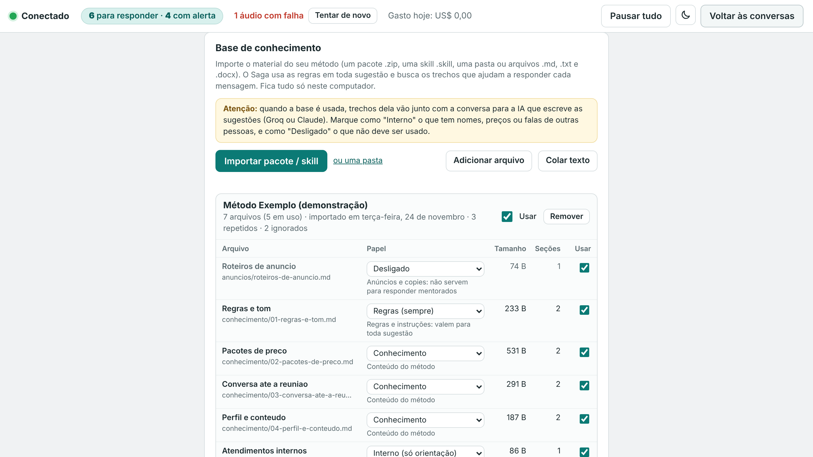

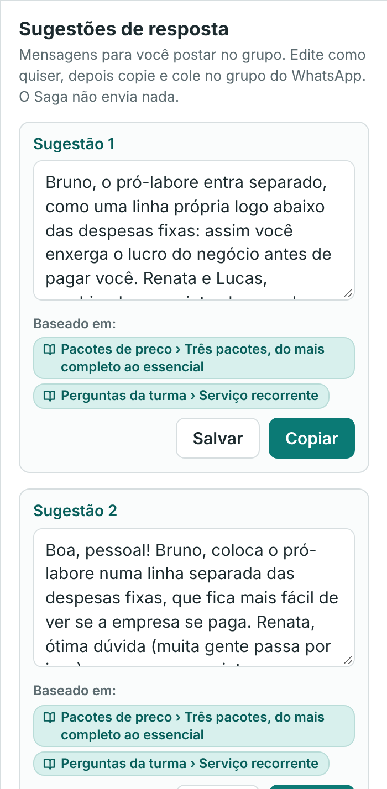

### Foco (versão 0.3.0)

O botão **Foco**, no alto da lista de conversas, apaga bem (desde a versão 0.3.1, quase some e fica sem cor) as conversas que **não precisam** da sua resposta (você falou por último, o SagaZap ou você marcou "Não precisa responder", ou foi respondido no grupo). Elas continuam na lista e dá para abrir normalmente; as que esperam a sua resposta ficam em destaque. Funciona junto com **Para responder**, **Com alerta**, **Individuais/Grupos** e a busca, nos dois temas. Clique de novo para desligar; o SagaZap lembra a escolha neste computador.

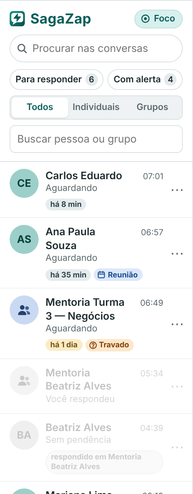

### Sem conversas escondidas (versão 0.3.0)

Como o telefone do SagaZap é só profissional, a opção **Mostrar escondidos** e o **Esconder/Mostrar** do menu ⋯ saíram. Se você tinha escondido alguma conversa numa versão anterior, ela volta a aparecer, e os áudios dela que ficaram sem baixar entram na fila aos poucos, no ritmo normal.

### Janela maximizada (versão 0.3.1)

O SagaZap abre com a janela **maximizada**. Se você tirar do maximizado (botão do meio, no canto de cima), ele lembra o tamanho e a posição e abre do mesmo jeito da próxima vez.

### Sugestões só quando a conversa precisa (versão 0.3.1)

Ao abrir uma conversa que **não precisa** da sua resposta (você falou por último, marcou "Não precisa responder" ou respondeu no grupo), o SagaZap não escreve resumo nem sugestões sozinho, para não gastar à toa. A coluna da direita mostra **Esta conversa não precisa de resposta agora.** Se quiser mesmo assim, clique em **Gerar sugestões mesmo assim**. Quando a pessoa mandar mensagem nova, as sugestões voltam a aparecer sozinhas.

### Procurar em todas as conversas (versão 0.3.1)

Use a caixa **Procurar nas conversas** (com a lupa), no alto da lista. Dá para escrever uma pergunta do jeito que você falaria, por exemplo **quem falou sobre preço?** — o SagaZap ignora palavras como "quem", "falou" e "sobre" e procura o assunto em todas as mensagens e nas **transcrições dos áudios**. Atalho: **Ctrl+F** (ou **Ctrl+K**).

- Os resultados aparecem no lugar da lista, por conversa, com quem mandou (nos grupos), a data e o trecho com as palavras em destaque.
- Clique num resultado para abrir a conversa já na mensagem, destacada.
- Filtros: **Todos / Individuais / Grupos**, período (**últimos 7 dias**, **30 dias** ou **todo o período**), **Só áudios** e uma conversa específica.
- Para uma frase exata, use aspas: **"plano de ação"**.
- **Resumir com IA** (opcional): manda até 30 trechos encontrados para a IA das sugestões e mostra uma resposta curta, com links para as conversas. Só acontece quando você clica e conta no teto de gasto diário.
- **Limpar** (ou a tecla Esc) volta para a lista normal.

A busca é feita no seu computador; nada sai dele, a não ser no **Resumir com IA**.

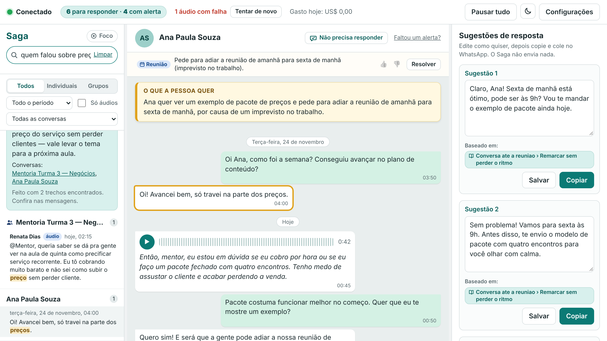

### Cópia de segurança (versão 0.3.1)

Para não perder o que o SagaZap aprendeu se trocar de computador, abra **Configurações › Cópia de segurança**.

1. **Exportar:** deixe marcado **Proteger com senha (recomendado)**, digite a senha duas vezes e clique em **Exportar cópia**. Escolha onde salvar o arquivo `SagaZap-copia-AAAA-MM-DD.sagabackup` (um pendrive, o Google Drive, o OneDrive…). **Anote a senha**: sem ela a cópia não abre.
   - A cópia leva as respostas aprovadas, os nomes e notas dos contatos, as avaliações (👍/👎, "Não precisa responder"), a base de conhecimento e as configurações (tema, IA, transcrição, teto, filtros).
   - **Não** leva as chaves de acesso nem a ligação com o WhatsApp: no computador novo, digite as chaves de novo e vincule o WhatsApp pelo QR Code (as mensagens voltam sozinhas). Se quiser levar também as mensagens e transcrições, marque **Incluir mensagens e transcrições (arquivo maior)**.
2. **Restaurar** (no computador novo): clique em **Restaurar cópia**, escolha o arquivo e digite a senha. O SagaZap mostra o que tem na cópia antes de mudar qualquer coisa. Escolha **Juntar com o que já existe** (o mais seguro: nada se repete e nada do que já está aqui é apagado) ou **Substituir** (troca o que está aqui pelo que está na cópia; o SagaZap pede confirmação).
3. **Cópia automática:** marque **Fazer cópia automática semanal** e clique em **Escolher pasta**. Dica: escolha uma pasta do **Google Drive** ou do **OneDrive** no seu computador — assim a cópia também fica guardada na nuvem. Uma vez por semana, quando o computador estiver parado, o SagaZap grava uma cópia ali e guarda as 5 mais novas. Dá para pôr uma senha nas cópias automáticas também. Embaixo aparece a data da **última cópia**.

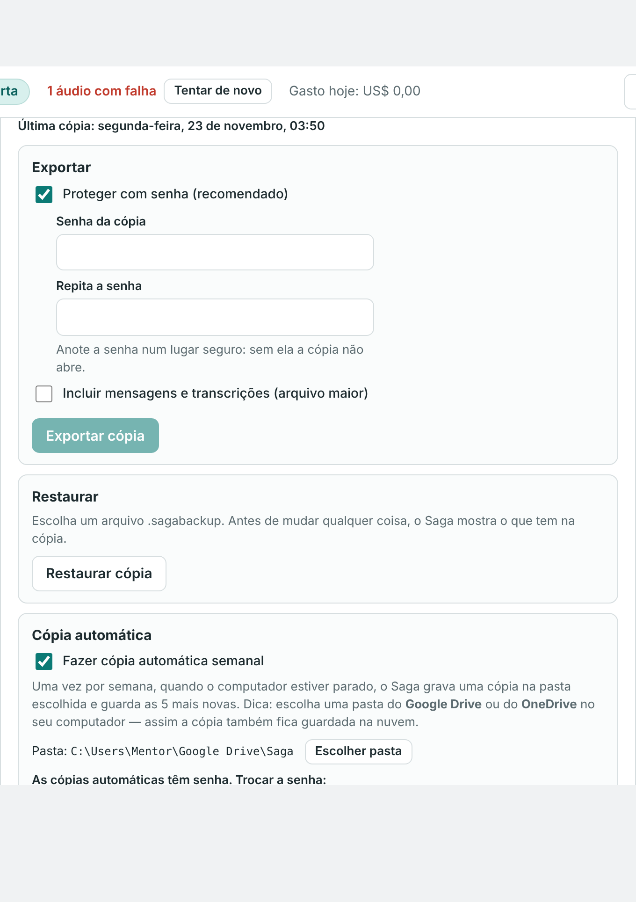

### Enviar pelo SagaZap (versão 0.4.0)

Agora dá para responder sem sair do SagaZap.

1. No cartão da sugestão, ajuste o texto e clique em **Enviar**.
2. Abre a confirmação: **para quem** vai (o nome e o número, ou o nome do grupo), nos grupos **a mensagem que vai ser citada** ("Respondendo a …") e o **texto final**, que ainda dá para mudar. Clique em **Enviar** (ou aperte **Ctrl+Enter**). **Cancelar** fecha sem enviar nada.
3. A resposta fica escolhida e guardada na memória (como no Copiar/Salvar), e o cartão mostra como está o envio.

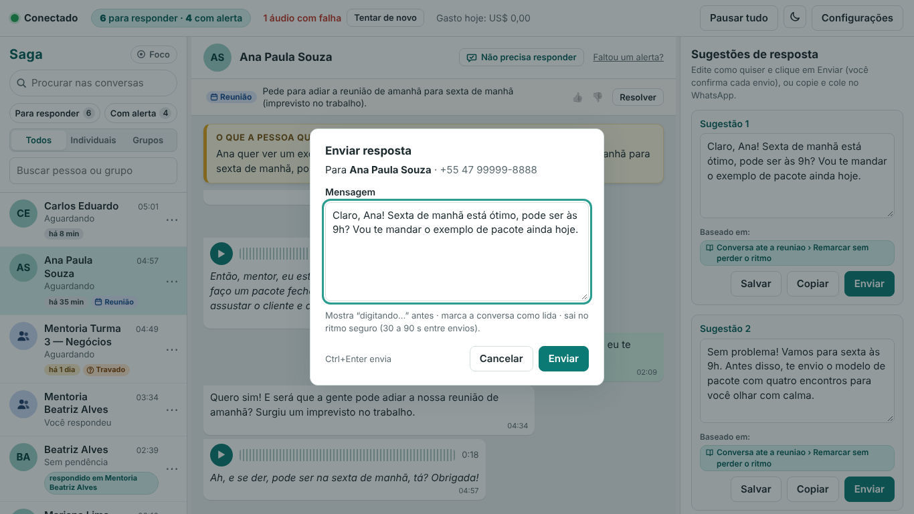

Nos grupos, a resposta sai **citando** a mensagem que você está respondendo: a mais recente que te marcou ou respondeu uma mensagem sua; se ninguém te marcou, a última mensagem depois da sua. Nas conversas individuais ela sai sem citação.

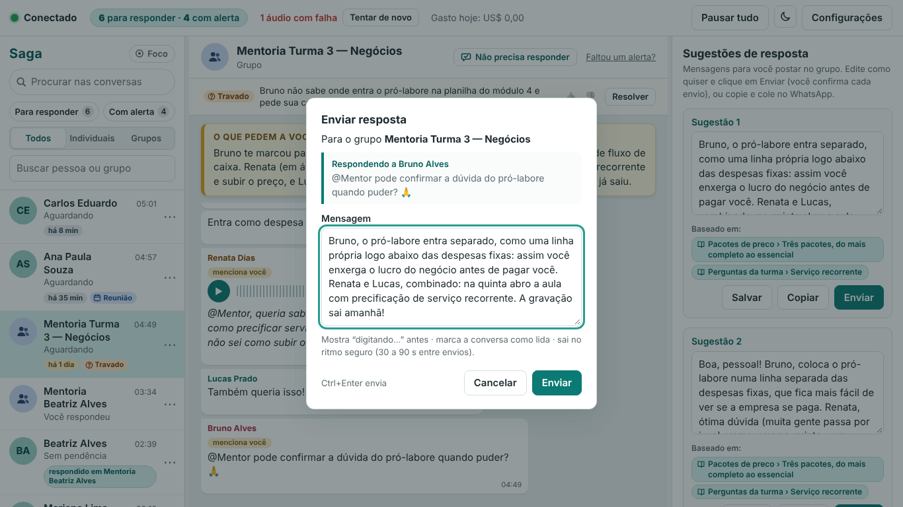

**O que cada estado do cartão quer dizer:**

| No cartão | O que significa | O que fazer |
|---|---|---|
| **Na fila — envia em 42 s** | Confirmada, esperando a vez. O SagaZap envia no máximo uma mensagem a cada 30 a 90 segundos. | Nada. Mudou de ideia? **Cancelar envio**. |
| **Na fila — pausado** | Você clicou em **Pausar tudo**. | **Retomar** no topo. Se passar de 10 minutos, o envio não sai mais sozinho (veja abaixo). |
| **Digitando…** | O SagaZap está mostrando "digitando…" para a pessoa, por alguns segundos (mais tempo para textos longos), e já vai enviar. | Nada. |
| **Enviada ✓ às 14:07** | O WhatsApp recebeu a mensagem. A conversa sai de "Para responder" assim que ela aparece no histórico, e os alertas se resolvem como quando você responde pelo celular. | Nada. |
| **Não enviada — tentar de novo** | Não saiu (por exemplo, a internet caiu antes de enviar). Nada chegou para a pessoa. | **Tentar de novo** abre a confirmação outra vez. |
| **Não enviada — a conexão caiu. Enviar de novo?** | A internet ou o WhatsApp caiu antes de a mensagem sair. **O SagaZap nunca envia sozinho depois de reconectar.** | Quando a faixa de cima voltar a **Conectado**, clique em **Enviar de novo** e confirme. |
| **Não enviada — aguardando confirmação** | Ficou mais de 10 minutos na fila, ou o SagaZap foi fechado antes de enviar. **O SagaZap nunca envia sozinho depois de reabrir ou reconectar.** | **Tentar de novo** e confirme, se ainda fizer sentido. |
| **Não sei se foi enviada — conferir** | A conexão caiu bem na hora do envio. O SagaZap procura a mensagem na conversa e, se ela aparecer, marca como enviada sozinho. | Clique em **Conferir**. Se ela não aparecer, olhe no celular: se não chegou, clique em **Enviar de novo** (o SagaZap pede a confirmação de novo; se a primeira chegar nesse meio-tempo, ele não manda a segunda). Se o WhatsApp ainda estiver respondendo ao primeiro envio, o SagaZap pede para esperar um pouco. |

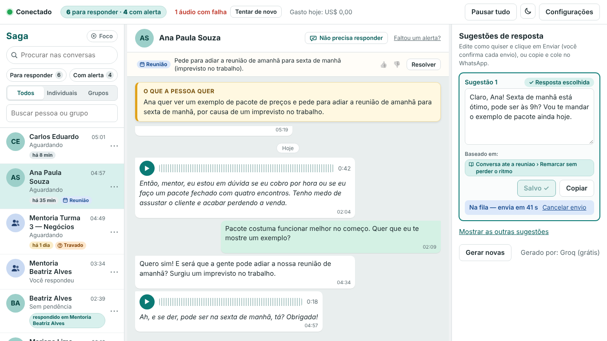

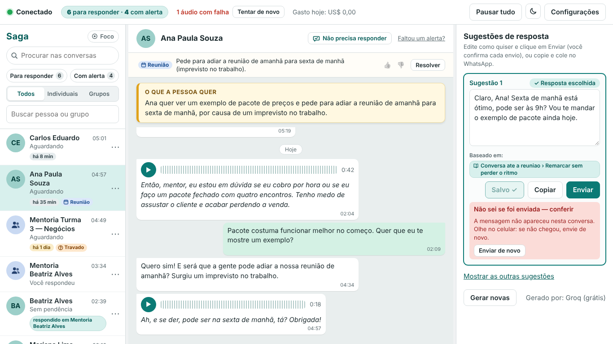

O botão **Enviar** só funciona com o WhatsApp **Conectado**; sem conexão, a confirmação avisa e não deixa enviar.

**Configurações › Envio direto** (tudo ligado por padrão):

- **Mostrar o botão Enviar nas sugestões**: desligado, o botão some e o SagaZap volta a ser só copiar e colar (o que estava na fila não sai).
- **Mostrar "digitando…" antes de enviar**.
- **Marcar como lidas as mensagens da conversa respondida**: só daquela conversa, nunca das outras.
- **Nos grupos, citar a mensagem que está sendo respondida**.

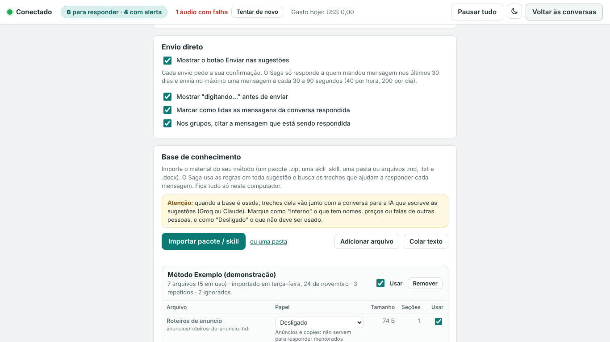

### Horário de envio e "Forçar envio" (versão 0.4.1)

Você escolhe em que dias e horários o SagaZap pode enviar. O padrão é **de segunda a sexta, das 09:00 às 18:00**; sábado e domingo ficam sem envio.

Para mudar, vá em **Configurações › Envio direto › Horário de envio**. Em cada dia, marque se pode enviar e escolha o horário de início e de fim (de 15 em 15 minutos). Vale o relógio do seu computador. Para enviar a qualquer hora, desmarque **Só enviar nos dias e horários abaixo**.

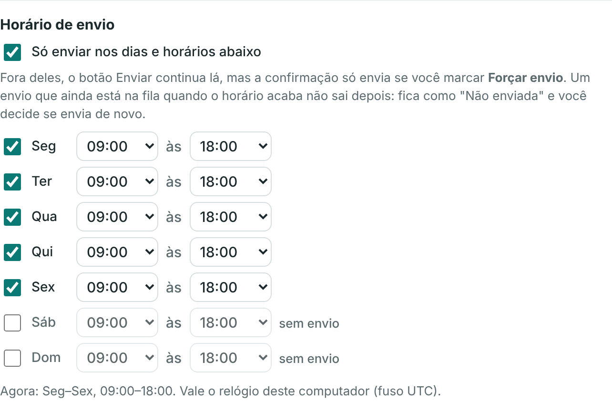

**Fora do horário:**

- No topo aparece **Fora do horário de envio**. Clique nele para abrir o horário nas Configurações.
- O botão **Enviar** continua no cartão. A confirmação avisa, por exemplo: "Fora do horário de envio (Seg–Sex, 09:00–18:00). Próximo horário: segunda 09:00." O botão de enviar fica desligado.
- Para enviar mesmo assim, marque **Forçar envio**. O botão vira **Enviar mesmo assim**. Todo o resto continua igual: você confirma, o SagaZap espera a vez, mostra "digitando…" e respeita os limites.

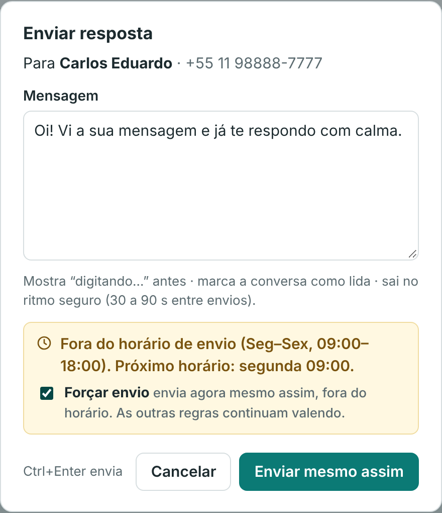

Vai responder várias mensagens da mesma pessoa fora do horário? Clique em **Forçar envio** no topo da conversa. Enquanto ele estiver ligado, a confirmação daquela conversa já abre com **Forçar envio** marcado. Ele desliga sozinho depois de 30 minutos ou quando você abre outra conversa. Você continua confirmando cada envio.

Se uma resposta ainda estiver na fila quando o horário acabar, ela **não sai depois**: o cartão mostra **Não enviada — fora do horário de envio. Enviar de novo?**. Para enviar, clique em **Enviar de novo** e marque **Forçar envio**, ou espere o próximo horário.

**Para não arriscar a sua conta (leia com atenção):** enviar por um aparelho vinculado não é um uso oficial do WhatsApp, e mandar muitas mensagens parecidas, rápido, é o que mais faz o WhatsApp limitar contas. Por isso o SagaZap:

- só envia para quem **mandou mensagem nos últimos 30 dias** (responde, nunca puxa conversa);
- pede a sua **confirmação em cada envio**, um por um;
- espera **30 a 90 segundos** entre um envio e outro (o dobro nos primeiros 15 minutos depois de abrir) e envia no máximo **40 por hora e 200 por dia**.

E você pode ajudar: responda de verdade a cada pessoa (evite mandar o mesmo texto para muita gente), não tente "zerar" dezenas de conversas de uma vez e continue usando o WhatsApp normalmente pelo celular. Se aparecer **Conta restrita pelo WhatsApp**, pare de enviar pelo SagaZap por alguns dias.

### Enviar mensagem avulsa (versão 0.6.0)

Para mandar uma mensagem que não é resposta a uma sugestão (um lembrete, um aviso, um "e aí, como foi?"):

1. Abra a conversa.
2. Na coluna da direita, clique em **Enviar mensagem avulsa**. Ele fica logo abaixo de **Gerar sugestões mesmo assim** (quando a conversa não precisa de resposta) ou no fim das sugestões.
3. Escreva a mensagem na caixa e clique em **Enviar**.
4. Confira para quem vai e clique em **Enviar** de novo (ou Ctrl+Enter).

Funciona igual às respostas: você confirma cada envio, o SagaZap espera a vez, mostra "digitando…", respeita o horário de envio (fora dele, marque **Forçar envio**) e os limites. Também só vai para quem mandou mensagem nos últimos 30 dias. A diferença: a mensagem avulsa **não cita** nenhuma mensagem (nem em grupo) e **não entra no aprendizado** das sugestões. Depois que ela sai, a conversa deixa de aparecer em "Para responder", como quando você responde pelo celular.

O botão só aparece com **Configurações › Envio direto** ligado. **Descartar** fecha a caixa e apaga o rascunho; depois de enviada, **Nova mensagem avulsa** abre a caixa vazia para outra.

### Copiloto da Saga (versão 0.5.0)

O SagaZap pode enviar ao **Copiloto da Saga** o que acontece nas conversas dos **mentorados cadastrados lá**: as mensagens (com os áudios já transcritos), os alertas, o "Para responder", os resumos e as respostas que você enviou. Entram também os grupos em que há um mentorado. Não vão as chaves de IA, as respostas aprovadas, a base de conhecimento, os arquivos de mídia nem nada de quem não é mentorado (num grupo, os números de quem não é mentorado ficam no computador).

Vem desligado. Para ligar, em **Configurações › Copiloto da Saga**:

1. Cole o **Endereço do Copiloto** (termina em `/functions/v1/sagazap-webhook`) e clique em **Salvar endereço**.
2. Clique em **Gerar código** e em **Copiar**. Cole o código no Lovable Cloud como o secret `SAGAZAP_WEBHOOK_SECRET`. O código aparece só essa vez; depois a tela mostra só **código configurado**.
3. Clique em **Testar conexão**. Aparece quantos telefones de mentorados o Copiloto mandou e quantas conversas deste computador são deles.
4. Marque **Enviar para o Copiloto da Saga**. Vão os últimos 30 dias dessas conversas e, depois, o que for acontecendo.

A linha embaixo mostra quantos eventos estão **pendentes**, o **último envio** e o **último erro**. Sem internet, o SagaZap tenta de novo sozinho, cada vez esperando mais (até 30 minutos). Se aparecer **Código do Copiloto inválido**, o envio para: gere outro código e cole no Copiloto de novo. Mentorado novo no Copiloto entra sozinho em até 6 horas (ou na hora, com **Testar conexão**).

Ao desligar, a fila deste computador é apagada. O que já foi enviado continua no Copiloto.

## 5. O que significa a faixa de cima

A faixa no topo mostra como o SagaZap está.

| Como aparece | O que significa | O que fazer |
|---|---|---|
|  | **Conectado**: tudo certo. "Tentar de novo" aparece só se algum áudio falhou. | Nada. |
|  | **Pausado**: você (ou o SagaZap) parou os downloads. | Clique em **Retomar**. |
|  | **Reconectando em …**: a internet caiu ou o WhatsApp oscilou. | Aguarde: o SagaZap tenta de novo sozinho, com esperas crescentes. |
| 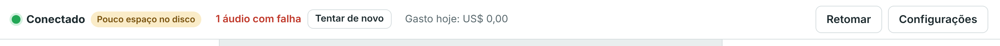 | **Pouco espaço no disco**: menos de 1 GB livre; os downloads param. | Libere espaço e clique em **Retomar**. |
| 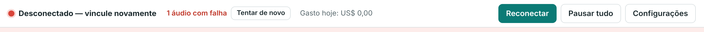 | **Desconectado — vincule novamente**: o WhatsApp foi desvinculado do celular. | Veja a seção abaixo. |

Outros avisos: **Desconectado — tente de novo** (clique em **Reconectar**); **Conta restrita pelo WhatsApp** (o WhatsApp limitou a conta: o SagaZap para tudo e mostra um aviso vermelho; use o WhatsApp só pelo celular por alguns dias e, quando quiser voltar, clique em **Reconectar**); **Conectado em outro lugar** (feche o outro aparelho ou programa e clique em **Reconectar**); **Versão do app desatualizada** (o WhatsApp recusou a conexão mesmo depois de o SagaZap buscar a versão mais nova do WhatsApp Web: clique em **Reconectar**; se continuar, instale a versão nova do SagaZap, veja "Atualizações"). Os avisos de conta restrita e de conectado em outro lugar continuam valendo mesmo se você fechar e abrir o SagaZap: ele só volta a se conectar quando você clicar em **Reconectar**. Já o de versão desatualizada some ao abrir o SagaZap de novo: ele busca a versão mais nova e tenta outra vez.

Também podem aparecer avisos sobre a transcrição dos áudios: **Transcrição pausada — confira a chave** (a chave não está configurada ou foi recusada: veja em **Configurações**), **Transcrição pausada — teto de gasto de hoje atingido** (só com a transcrição paga da OpenAI; volta sozinha no dia seguinte, ou aumente o teto em **Configurações**) e **Sem internet — transcrição volta em instantes**.

### Apareceu "vincule novamente"

Acontece quando o aparelho é removido em **WhatsApp › Aparelhos conectados** no celular. Clique em **Reconectar**: o SagaZap mostra um QR Code novo por cima das conversas. No celular, abra **WhatsApp › Aparelhos conectados › Conectar um aparelho** e aponte a câmera para o código. Se o código não aparecer ou expirar, clique em **Gerar novo QR Code**. As conversas já importadas continuam guardadas.

### QR Code não aparece

Se o passo do QR Code fica em "Preparando o QR Code…":

1. **Espere uns 30 segundos.** Na primeira vez o SagaZap confere a versão atual do WhatsApp Web antes de pedir o código.
2. Clique em **Tentar de novo** (ou em **Gerar novo QR Code**).
3. **Antivírus e firewall:** confira se eles permitem que o SagaZap acesse a internet. Alguns antivírus bloqueiam a conexão com o WhatsApp sem avisar; libere o `SagaZap.exe` (ou adicione o SagaZap às exceções) e clique em **Tentar de novo**. Em redes de empresa ou com proxy, teste em outra rede (por exemplo, o roteador do celular).
4. Se depois de 45 segundos ainda não aparecer, o SagaZap mostra "O QR Code está demorando". Clique em **Ver detalhes** e depois em **Copiar diagnóstico**, e cole o texto numa mensagem para o suporte. O diagnóstico traz só as versões do app e o registro da conexão: **nunca** as suas mensagens nem as chaves. O mesmo botão fica em **Configurações › Diagnóstico**, junto com **Abrir pasta de registros** (o arquivo `saga.log`).

### Botão Pausar

**Pausar tudo** interrompe os downloads de áudio e os envios na hora (útil se o computador ou a internet estiver lento). **Retomar** continua de onde parou; um envio que ficou mais de 10 minutos parado não sai mais sozinho e pede a sua confirmação de novo. O SagaZap também pausa sozinho quando o espaço em disco acaba.

## 6. Atualizações

> **Novo nome (versão 0.4.2):** o Saga agora se chama **SagaZap**, com ícone novo. A atualização é automática, como sempre: as conversas, a conexão com o WhatsApp, as chaves, a base de conhecimento e as configurações continuam como estavam (a pasta de dados é a mesma). O atalho **Saga** da área de trabalho e do menu Iniciar vira **SagaZap**; se você tinha o Saga fixado na barra de tarefas, ele continua lá e abre o SagaZap. O **Iniciar com o Windows** continua valendo. As cópias de segurança novas se chamam `SagaZap-copia-…`; as antigas `Saga-copia-…` continuam abrindo normalmente.

> **Importante (versão 0.2.3):** nas versões até a 0.2.2 o app quase nunca procurava atualizações (só uma vez ao iniciar e depois a cada 6 horas), por isso o aviso não aparecia. **Instale a 0.2.3 manualmente uma última vez** (baixe o `.exe` no link abaixo e instale por cima). A partir dela o aviso aparece sozinho.

O SagaZap procura uma versão nova **30 segundos depois de abrir**, **a cada hora** (mesmo fechado na bandeja), **sempre que você abre a janela** e quando o computador **volta da suspensão**. Quando existe uma versão nova, aparece na faixa de cima (e também no assistente de configuração, se você estiver nele):

Clique em **Atualizar**. O SagaZap baixa a versão nova e a instala **quando você fechar o SagaZap** (pelo ícone da bandeja › **Sair**). Se quiser instalar na hora, clique em **Reiniciar e atualizar**: o SagaZap fecha com cuidado, instala a versão nova e abre de novo. Se preferir, baixe o novo `.exe` em <https://github.com/caionorcia/saga/releases/latest> e instale por cima da versão antiga: suas conversas e configurações são mantidas.

Em **Configurações › Atualizações** você vê a versão instalada, quando o SagaZap procurou pela última vez e o resultado ("você já está na versão mais nova", "nova versão disponível" ou o motivo de não ter conseguido verificar, por exemplo sem internet). O botão **Verificar agora** procura na hora.

Se o aviso não aparecer mesmo com uma versão nova publicada, clique em **Configurações › Diagnóstico › Copiar diagnóstico** e mande para o suporte: o registro mostra cada procura (`update_checking`, `update_available`, `update_not_available`, `update_error` com o motivo).

## 7. Privacidade

- Suas conversas, áudios e configurações ficam **neste computador** (pasta de dados do SagaZap no seu usuário do Windows). Não existe servidor do SagaZap.
- A chave de acesso é guardada com a criptografia do Windows.
- Só saem do computador: o **texto das conversas** e os **áudios**, enviados para a IA que você escolheu (Groq e, se configurado, Claude ou OpenAI) para transcrever e gerar sugestões, e, se você importou uma **base de conhecimento**, o resumo das regras e os trechos usados em cada sugestão.
- Com o **Copiloto da Saga** ligado (vem desligado), as conversas dos mentorados cadastrados lá também vão para o Copiloto (veja "Copiloto da Saga").
- O SagaZap lê conversas individuais e grupos. Ele só escreve no WhatsApp quando você confirma um envio (a mensagem, o "digitando…" e marcar como lida aquela conversa) e nunca muda nada nos grupos. Status, canais e listas de transmissão são ignorados.

## 8. Desinstalar

**Configurações do Windows › Aplicativos › SagaZap › Desinstalar**. Depois, para apagar também os dados, apague a pasta `saga` dentro de `%APPDATA%` (cole `%APPDATA%\saga` na barra de endereços do Explorador de Arquivos). A pasta manteve o nome antigo de propósito, para a troca de nome para SagaZap não perder nada.
