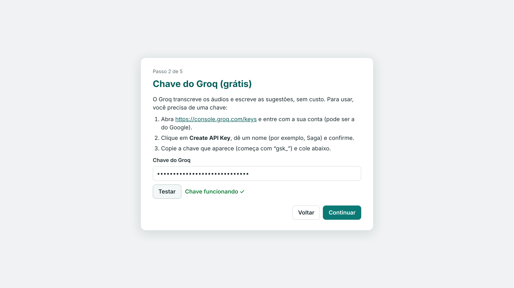
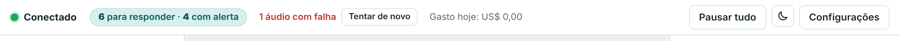
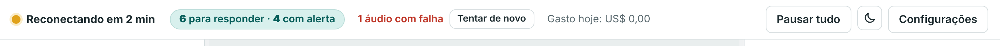
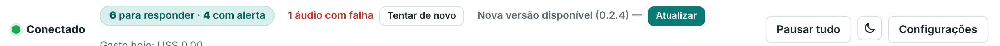
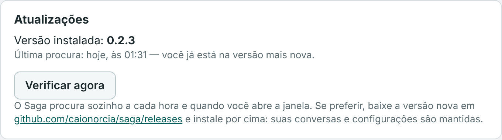

# Guia de instalação do Saga

Este guia é para quem **não usa terminal**. Você só vai clicar e copiar/colar. Leva uns 10 minutos.

O Saga lê as suas conversas individuais do WhatsApp (dos últimos 30 dias), transcreve os áudios e sugere respostas. **Ele nunca envia mensagens**: você copia a sugestão e cola no WhatsApp.

## 1. Baixar o instalador

1. No navegador, abra: <https://github.com/caionorcia/saga/releases/latest>
2. Role a página até a parte **Assets** (arquivos).
3. Clique em **Saga-Setup-…exe** (o número da versão aparece no nome). O download começa.
4. Quando terminar, abra o arquivo pela lista de downloads do navegador ou pela pasta **Downloads**.

## 2. Instalar (aviso do Windows)

Na primeira vez, o Windows pode mostrar uma tela azul: **"O Windows protegeu o computador"**. Isso é normal: o Saga é um programa novo e ainda não tem a assinatura paga que a Microsoft reconhece. Não significa que há um vírus.

1. Clique em **Mais informações** (um texto pequeno, logo abaixo da mensagem).
2. Vai aparecer o botão **Executar assim mesmo**. Clique nele.
3. O instalador abre. Clique em **Instalar** e aguarde.
4. No fim, o Saga abre sozinho e um atalho **Saga** aparece na área de trabalho.

## 3. Assistente de configuração

O Saga mostra um assistente em 5 passos.

### Passo 1: Boas-vindas

Leia o aviso e clique em **Entendi, vamos começar**. O Saga usa o WhatsApp como um aparelho vinculado (como o WhatsApp Web). Esse uso não é oficial e há um pequeno risco de o WhatsApp limitar a conta; por isso o Saga só lê, vai devagar e nunca marca nada como lido.

### Passo 2: Chave do Groq (grátis)

A chave é uma "senha" que permite ao Saga usar a inteligência artificial do Groq, de graça. Para criar:

1. Abra <https://console.groq.com/keys> e entre com a sua conta Google ou e-mail (crie uma conta se for a primeira vez).
2. Clique em **Create API Key** (criar chave) e dê um nome, por exemplo "Saga".
3. Clique em **Copy** (copiar). A chave começa com `gsk_`. Ela só aparece uma vez.
4. Volte ao Saga, cole no campo e clique em **Testar**. Deve aparecer **Chave funcionando ✓**.
5. Clique em **Continuar**.

### Passo 3: Chave do Claude (opcional)

Você pode **pular** este passo. É para quem prefere que o Claude (pago, por uso) escreva as sugestões. Dá para configurar depois em **Configurações**.

### Passo 4: Vincular o WhatsApp (QR Code)

1. No celular: **WhatsApp › Aparelhos conectados › Conectar um aparelho**.
2. Aponte a câmera do celular para o QR Code na tela do computador.
3. O código troca de tempos em tempos. Se ele não aparecer ou o celular não aceitar, clique em **Gerar novo QR Code**.

Quando vincular, o assistente avança sozinho.

Embaixo do código aparece a **Situação** da conexão. Se algo der errado, o Saga explica o motivo e mostra o botão **Tentar de novo**. Se o QR Code não aparecer, veja [QR Code não aparece](#qr-code-não-aparece).

### Passo 5: Importação

O Saga traz os últimos 30 dias de conversas e baixa os áudios aos poucos, de propósito devagar, para não sobrecarregar o WhatsApp. Você já pode clicar em **Começar a usar**.

## 4. Usando o Saga

- **Esquerda:** as conversas, pessoas e grupos. O selo "há 3 h" indica que alguém está aguardando a sua resposta e há quanto tempo (num grupo: a última mensagem não é sua). No topo, escolha **Todos**, **Individuais** ou **Grupos**; o Saga lembra a escolha. A busca procura pessoas e grupos.
- **Meio:** a conversa, com os áudios já transcritos e o resumo "O que a pessoa quer". Nos grupos, cada mensagem mostra o nome de quem mandou, as que mencionam você aparecem marcadas, e o resumo se chama "O que pedem a você": perguntas e pedidos para você, não um resumo do grupo inteiro.
- **Direita:** sugestões de resposta (num grupo, mensagens para você postar no grupo). Edite como quiser, clique em **Copiar** e cole no WhatsApp. **Salvar** guarda a sua versão final para o Saga aprender o seu jeito. **Gerar novas** pede outras sugestões.

### Fila do dia e alertas (versão 0.2.0)

Para ninguém ficar sem resposta:

- **Para responder**: o botão no alto da lista mostra só quem está esperando a sua resposta, **quem espera há mais tempo primeiro**. O número no botão diz quantas conversas são. O selo de cada conversa diz há quanto tempo a pessoa espera: cinza até 1 dia, **amarelo** de 1 a 2 dias e **vermelho** depois de 2 dias. Clique de novo no botão para voltar a ver todas.
- **Com alerta**: mostra as conversas que pedem atenção, as mais graves primeiro. Os alertas aparecem como etiquetas coloridas na conversa: **Urgente** (pressa ou prazo), **Desânimo** (frustração, vontade de desistir, reclamação), **Travado** (uma dúvida impedindo de avançar), **Reunião** (pedido de reunião, ligação ou horário) e **Esperando 2 dias** (sem resposta há mais de 2 dias).
- Ao abrir a conversa, uma faixa logo abaixo do nome explica cada alerta. Clique no texto do alerta para ir até a mensagem; clique em **Resolver** para tirá-lo da lista.
- Quando você responde pelo WhatsApp, os alertas de Urgente, Travado, Reunião e Esperando somem sozinhos. O de **Desânimo** fica até você clicar em **Resolver**, para você lembrar de acompanhar a pessoa.
- Na faixa de cima, "**5 para responder · 2 com alerta**" mostra o resumo do dia; clique nele para abrir a lista **Para responder**.

Os alertas são procurados aos poucos, em segundo plano, pela IA **gratuita** da Groq (a mesma chave da transcrição), uma conversa de cada vez e só quando chega mensagem nova. O Saga **nunca** usa o Claude (pago) para isso. Sem a chave da Groq, só o alerta "Esperando" funciona. Contatos escondidos não são analisados.

### Ensinar o Saga: 👍 e 👎 nos alertas (versão 0.2.1)

- Cada alerta da IA tem dois botões na faixa da conversa: **👍** (o alerta está certo) e **👎** (está errado). O 👍 não tira o alerta: ele continua até você resolver.
- O **👎** abre a janela "**O que está errado neste alerta?**". Escolha o motivo (por exemplo "Era brincadeira/ironia" ou "Não era comigo"); em "**Não é esse tipo de alerta**", diga qual seria o certo — o Saga troca o alerta por esse, marcado como "marcado por você". Se quiser, explique com suas palavras. Ao salvar, o alerta errado sai da lista.
- O Saga deixou passar algo? Clique em "**Faltou um alerta?**", no canto do cabeçalho da conversa, escolha o tipo e, se quiser, a mensagem e um comentário. O alerta é criado na hora.
- Cada avaliação vira um exemplo para a IA: as próximas análises levam alguns desses exemplos e o Saga não repete um alerta que você marcou como errado na mesma mensagem.
- Em **Configurações → Qualidade dos alertas** você vê, por tipo, quantos 👍, 👎 e "faltou" houve nos últimos 30 dias e a % de acerto. O botão **Exportar avaliações (CSV)** salva uma planilha que abre no Excel. Com "**Anonimizar nomes**" (ligado por padrão), o nome de cada conversa vira "Contato 1", "Contato 2"… **Atenção:** a planilha traz trechos das mensagens; guarde e compartilhe com cuidado.

Fechar a janela (no X) **não** encerra o Saga: ele continua na bandeja, perto do relógio. Para sair de verdade, clique com o botão direito no ícone e escolha **Sair**.

### "Para responder" mais certeiro (versão 0.2.2)

- Nem toda mensagem pede resposta. Quando a pessoa só manda "**obrigado**", "**ok**", "**valeu**", um **emoji** (👍 🙏) ou uma figurinha depois da sua resposta, o Saga tira a conversa de **Para responder** sozinho. A IA gratuita também avisa quando a mensagem é só informativa ou, num grupo, quando a conversa é entre os participantes e não com você. Na dúvida, a conversa fica na lista.
- Essas conversas continuam em **Todos**, com a etiqueta cinza "**Não precisa responder**". Ao abrir, aparece "O Saga acha que esta conversa não precisa de resposta" e o motivo. Se ele errou, clique em **Precisa sim** e a conversa volta para a lista. Se ele acertou, clique em 👍.
- O Saga deixou alguém na lista sem precisar? Clique em **Não precisa responder** (no alto da conversa, ou no ícone 💬✓ ao lado do nome, na lista **Para responder**) e escolha o motivo: "Era só agradecimento / ok / emoji", "Respondi no grupo dele", "Respondi por ligação/pessoalmente", "Mensagem de grupo que não é comigo", "Conversa encerrada" ou "Outro". A conversa sai da lista e o alerta "Esperando" some.
- Isso vale até a pessoa mandar outra mensagem: aí a conversa volta para a lista e o Saga olha de novo.
- O alerta **Esperando** e os alertas "marcados por você" agora também têm 👍 e 👎. No Esperando, o 👍 diz "precisa mesmo responder" e o 👎 abre a mesma janela "Por que esta conversa não precisa de resposta?".
- Tudo isso ensina o Saga. Em **Configurações → Qualidade dos alertas**, a linha **Para responder** mostra quantas conversas você tirou, quantas devolveu e a % de acerto do Saga; essas avaliações também vão na planilha exportada (tipo "para_responder").

### Respondido no grupo do mentorado (versão 0.2.3)

Cada mentorado costuma ter o próprio grupo, e é lá que você responde. O Saga agora entende isso sozinho:

- Se a pessoa mandou mensagem no privado e **depois** disso você escreveu num grupo de que ela participa, a conversa sai de **Para responder** (e não ganha o alerta "Esperando").
- Na lista **Todos**, a conversa aparece com a etiqueta "**respondido em** _nome do grupo_".
- Ao abrir a conversa, aparece "**Respondido no grupo** _nome do grupo_ **às** _hora_". Clique no nome do grupo para abrir a conversa do grupo.
- Se ainda precisa responder no privado, clique em **Precisa sim**: a conversa volta para a lista (e o Saga aprende com isso). Se estiver certo, clique em 👍.
- O Saga sabe quem está em cada grupo pela lista de participantes (consultada uma vez por dia, só leitura) e por quem já escreveu no grupo. Logo depois de atualizar, a lista de participantes é buscada na primeira conexão.

### Tema escuro (versão 0.2.3)

Em **Configurações › Tema**, escolha **Automático (do Windows)** (o padrão: segue o modo claro/escuro do Windows), **Claro** ou **Escuro**. Para trocar rápido, use o botão de **sol/lua** na barra de cima, ao lado de **Configurações**. O QR Code continua em fundo branco para o celular conseguir ler.

## 5. O que significa a faixa de cima

A faixa no topo mostra como o Saga está.

| Como aparece | O que significa | O que fazer |
|---|---|---|
|  | **Conectado**: tudo certo. "Tentar de novo" aparece só se algum áudio falhou. | Nada. |
|  | **Pausado**: você (ou o Saga) parou os downloads. | Clique em **Retomar**. |
|  | **Reconectando em …**: a internet caiu ou o WhatsApp oscilou. | Aguarde: o Saga tenta de novo sozinho, com esperas crescentes. |
|  | **Pouco espaço no disco**: menos de 1 GB livre; os downloads param. | Libere espaço e clique em **Retomar**. |
|  | **Desconectado — vincule novamente**: o WhatsApp foi desvinculado do celular. | Veja a seção abaixo. |

Outros avisos: **Desconectado — tente de novo** (clique em **Reconectar**); **Conta restrita pelo WhatsApp** (o WhatsApp limitou a conta: o Saga para tudo e mostra um aviso vermelho; use o WhatsApp só pelo celular por alguns dias e, quando quiser voltar, clique em **Reconectar**); **Conectado em outro lugar** (feche o outro aparelho ou programa e clique em **Reconectar**); **Versão do app desatualizada** (o WhatsApp recusou a conexão mesmo depois de o Saga buscar a versão mais nova do WhatsApp Web: clique em **Reconectar**; se continuar, instale a versão nova do Saga, veja "Atualizações"). Os avisos de conta restrita e de conectado em outro lugar continuam valendo mesmo se você fechar e abrir o Saga: ele só volta a se conectar quando você clicar em **Reconectar**. Já o de versão desatualizada some ao abrir o Saga de novo: ele busca a versão mais nova e tenta outra vez.

Também podem aparecer avisos sobre a transcrição dos áudios: **Transcrição pausada — confira a chave** (a chave não está configurada ou foi recusada: veja em **Configurações**), **Transcrição pausada — teto de gasto de hoje atingido** (só com a transcrição paga da OpenAI; volta sozinha no dia seguinte, ou aumente o teto em **Configurações**) e **Sem internet — transcrição volta em instantes**.

### Apareceu "vincule novamente"

Acontece quando o aparelho é removido em **WhatsApp › Aparelhos conectados** no celular. Clique em **Reconectar**: o Saga mostra um QR Code novo por cima das conversas. No celular, abra **WhatsApp › Aparelhos conectados › Conectar um aparelho** e aponte a câmera para o código. Se o código não aparecer ou expirar, clique em **Gerar novo QR Code**. As conversas já importadas continuam guardadas.

### QR Code não aparece

Se o passo do QR Code fica em "Preparando o QR Code…":

1. **Espere uns 30 segundos.** Na primeira vez o Saga confere a versão atual do WhatsApp Web antes de pedir o código.
2. Clique em **Tentar de novo** (ou em **Gerar novo QR Code**).
3. **Antivírus e firewall:** confira se eles permitem que o Saga acesse a internet. Alguns antivírus bloqueiam a conexão com o WhatsApp sem avisar; libere o `Saga.exe` (ou adicione o Saga às exceções) e clique em **Tentar de novo**. Em redes de empresa ou com proxy, teste em outra rede (por exemplo, o roteador do celular).
4. Se depois de 45 segundos ainda não aparecer, o Saga mostra "O QR Code está demorando". Clique em **Ver detalhes** e depois em **Copiar diagnóstico**, e cole o texto numa mensagem para o suporte. O diagnóstico traz só as versões do app e o registro da conexão: **nunca** as suas mensagens nem as chaves. O mesmo botão fica em **Configurações › Diagnóstico**, junto com **Abrir pasta de registros** (o arquivo `saga.log`).

### Botão Pausar

**Pausar tudo** interrompe os downloads de áudio na hora (útil se o computador ou a internet estiver lento). **Retomar** continua de onde parou. O Saga também pausa sozinho quando o espaço em disco acaba.

## 6. Atualizações

> **Importante (versão 0.2.3):** nas versões até a 0.2.2 o Saga quase nunca procurava atualizações (só uma vez ao iniciar e depois a cada 6 horas), por isso o aviso não aparecia. **Instale a 0.2.3 manualmente uma última vez** (baixe o `.exe` no link abaixo e instale por cima). A partir dela o aviso aparece sozinho.

O Saga procura uma versão nova **30 segundos depois de abrir**, **a cada hora** (mesmo fechado na bandeja), **sempre que você abre a janela** e quando o computador **volta da suspensão**. Quando existe uma versão nova, aparece na faixa de cima (e também no assistente de configuração, se você estiver nele):

Clique em **Atualizar**. O Saga baixa a versão nova e a instala **quando você fechar o Saga** (pelo ícone da bandeja › **Sair**). Se quiser instalar na hora, clique em **Reiniciar e atualizar**: o Saga fecha com cuidado, instala a versão nova e abre de novo. Se preferir, baixe o novo `.exe` em <https://github.com/caionorcia/saga/releases/latest> e instale por cima da versão antiga: suas conversas e configurações são mantidas.

Em **Configurações › Atualizações** você vê a versão instalada, quando o Saga procurou pela última vez e o resultado ("você já está na versão mais nova", "nova versão disponível" ou o motivo de não ter conseguido verificar, por exemplo sem internet). O botão **Verificar agora** procura na hora.

Se o aviso não aparecer mesmo com uma versão nova publicada, clique em **Configurações › Diagnóstico › Copiar diagnóstico** e mande para o suporte: o registro mostra cada procura (`update_checking`, `update_available`, `update_not_available`, `update_error` com o motivo).

## 7. Privacidade

- Suas conversas, áudios e configurações ficam **neste computador** (pasta de dados do Saga no seu usuário do Windows). Não existe servidor do Saga.
- A chave de acesso é guardada com a criptografia do Windows.
- Só saem do computador: o **texto das conversas** e os **áudios**, enviados para a IA que você escolheu (Groq e, se configurado, Claude ou OpenAI) para transcrever e gerar sugestões.
- O Saga lê conversas individuais e grupos, sem nunca escrever nem mudar nada neles. Status, canais e listas de transmissão são ignorados.

## 8. Desinstalar

**Configurações do Windows › Aplicativos › Saga › Desinstalar**. Depois, para apagar também os dados, apague a pasta `Saga` dentro de `%APPDATA%` (cole esse nome na barra de endereços do Explorador de Arquivos).
